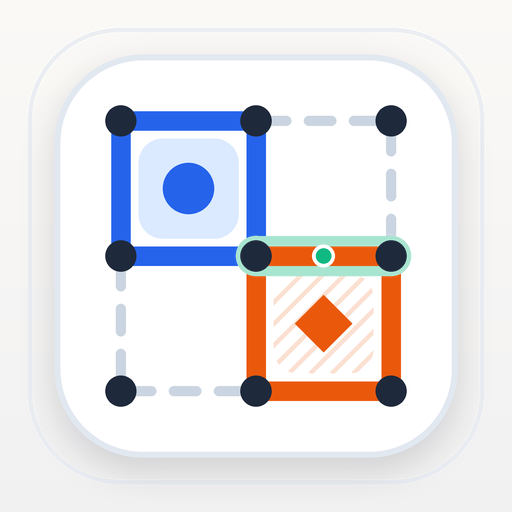
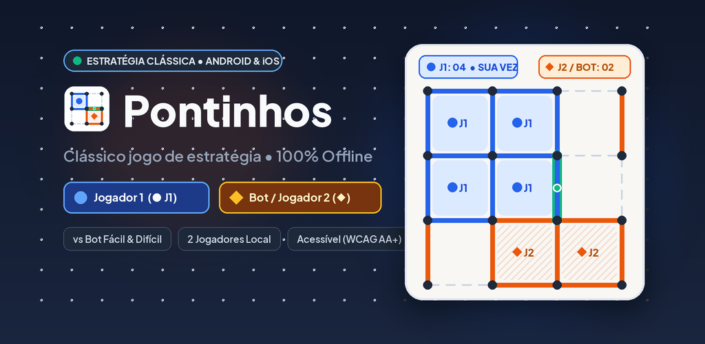
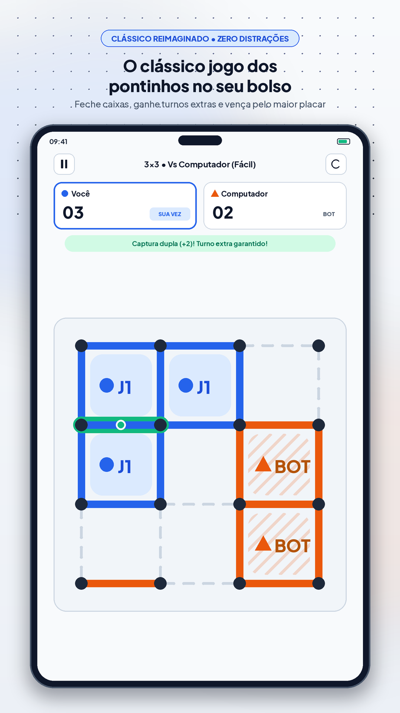
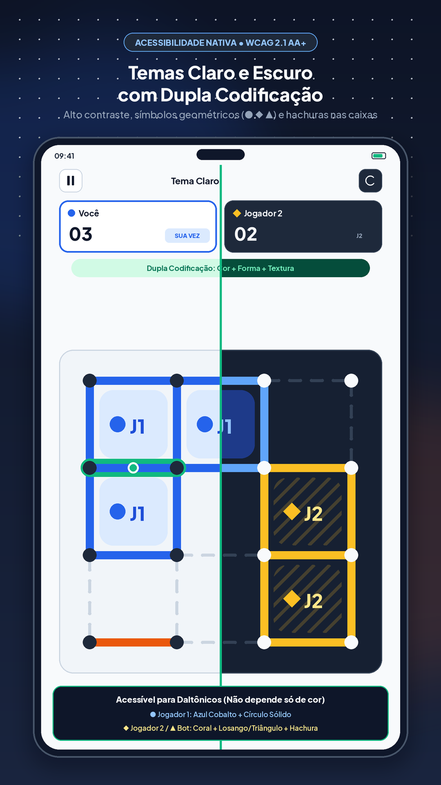
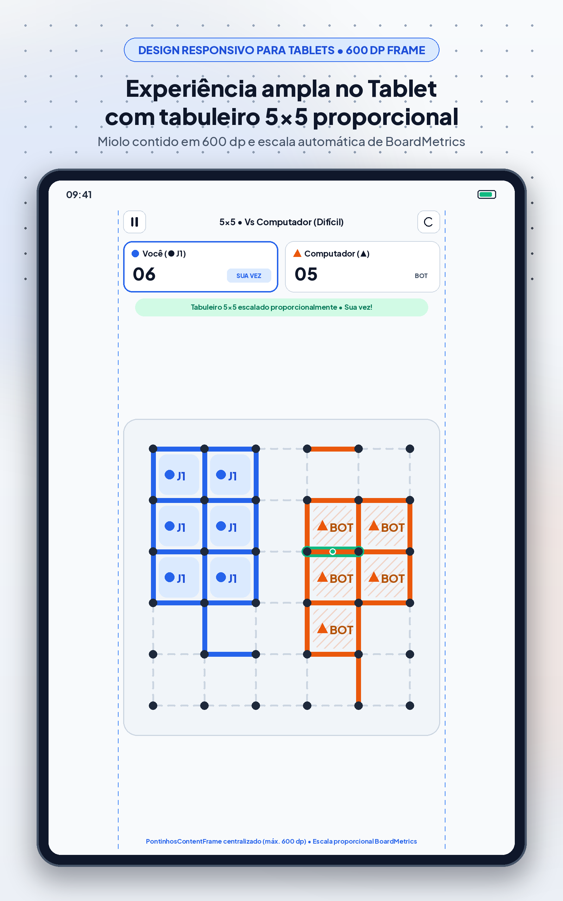
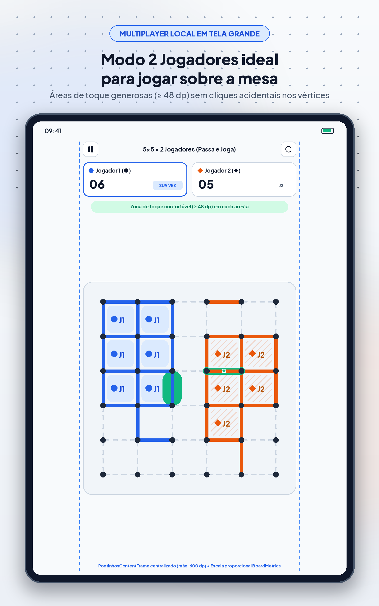
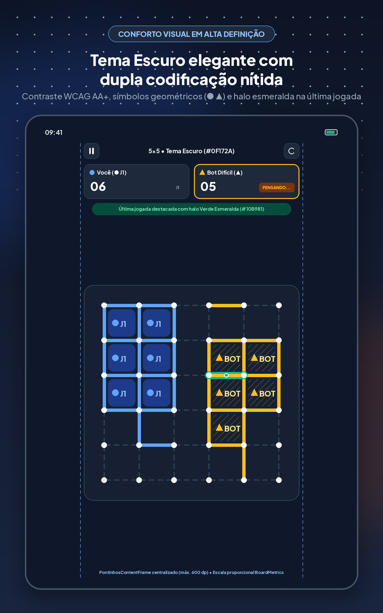
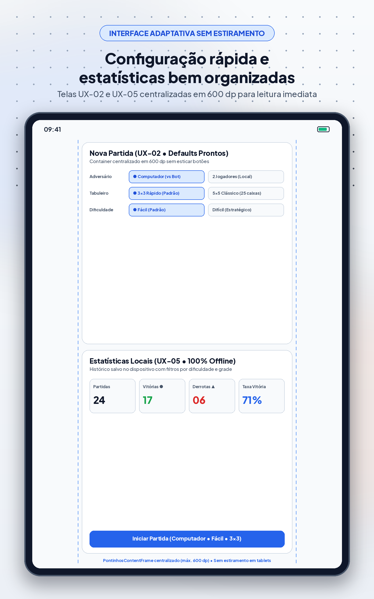
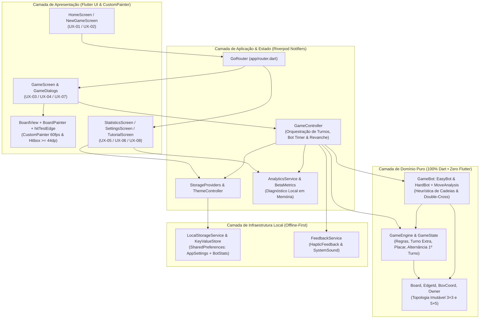

<div align="center">



# Pontinhos

**O clássico Jogo dos Pontinhos (*Dots and Boxes*) reinventado para Android e iOS — 100% Offline, Acessível e Estratégico.**

*A nostalgia tátil do papel e caneta com precisão digital a 60 fps, estética **Tactile Paper & Ink**, zero anúncios e zero coleta de dados.*

[](https://flutter.dev)
[](https://dart.dev)
[](https://riverpod.dev)
[](https://pub.dev/packages/go_router)
[-10B981)](https://github.com/regardgames/pontinhos-mobile/releases/tag/v0.1.0-beta.1)
[-16A34A)](#qualidade-testes-e-roadmap-consolidado)
[](#acessibilidade-universal-wcag-21-aa-e-design-system)
[](docs/PRIVACY_POLICY.md)
[](#como-executar-testar-e-gerar-builds)

<br />



<br />

[**🌐 Página Promocional (GitHub Pages)**](https://regardgames.github.io/pontinhos/) · [**📲 Baixar APK Beta (`v0.1.0-beta.1`)**](https://github.com/regardgames/pontinhos-mobile/releases/download/v0.1.0-beta.1/pontinhos-v0.1.0-release.apk) · [**📦 Release Completa (`.apk` / `.aab`)**](https://github.com/regardgames/pontinhos-mobile/releases/tag/v0.1.0-beta.1) · [**🎨 Design System & UX**](docs/DESIGN_SYSTEM_UX.md) · [**🔒 Política de Privacidade**](docs/PRIVACY_POLICY.md) · [**🔒 Política de Privacidade (Web)**](https://regardgames.github.io/pontinhos/privacy-policy.html)

</div>

---

## Sumário

1. [Sobre o Jogo & Proposta de Valor](#sobre-o-jogo--proposta-de-valor)
2. [Principais Funcionalidades & Modos de Jogo](#principais-funcionalidades--modos-de-jogo)
3. [Acessibilidade Universal (WCAG 2.1 AA+) e Design System](#acessibilidade-universal-wcag-21-aa-e-design-system)
4. [Galeria Visual (Smartphones & Tablets)](#galeria-visual-smartphones--tablets)
5. [Arquitetura de Engenharia & Stack Tecnológica](#arquitetura-de-engenharia--stack-tecnológica)
6. [Como Executar, Testar e Gerar Builds](#como-executar-testar-e-gerar-builds)
7. [Qualidade, Testes e Roadmap Consolidado](#qualidade-testes-e-roadmap-consolidado)
8. [Índice da Documentação & Privacidade](#índice-da-documentação--privacidade)

---

## Sobre o Jogo & Proposta de Valor

Todo mundo já desenhou uma grade de pontinhos na última folha do caderno para disputar quem fechava mais quadrados. **Pontinhos** (`com.regard.pontinhos`) resgata a essência tática do clássico *Dots and Boxes* em uma experiência mobile moderna, silenciosamente elegante e livre das distrações dos jogos casuais atuais.

### Por que o Pontinhos existe?

- **Estética *Tactile Paper & Ink*:** Inspirado na textura acolhedora do papel sulfite e no contraste nítido da tinta hidrográfica, o visual prioriza foco cognitivo, legibilidade instantânea e conforto visual tanto no **Tema Claro (*Warm Paper*)** quanto no **Tema Escuro (*Midnight Slate*)**.
- **Partidas Rápidas, Sem Fricção:** Da abertura do aplicativo ao primeiro traço no tabuleiro em **menos de 2 segundos**. A tela de configuração já vem com padrões inteligentes pré-selecionados para começar com 1 toque.
- **100% Offline, Sem Anúncios e Sem Cadastro:** Jogue no avião, no metrô ou em qualquer lugar sem internet. Não há banners publicitários, vídeos forçados, moedas virtuais, *loot boxes* nem criação de conta.
- **Privacidade Absoluta (*Zero Data Collection*):** Nenhum dado pessoal, identificador de dispositivo (`AD_ID` / `IDFA`) ou telemetria de rede sai do aparelho. Preferências e estatísticas ficam salvas exclusivamente no armazenamento local do dispositivo (`SharedPreferences`).

---

## Principais Funcionalidades & Modos de Jogo

### 1. Tamanhos de Tabuleiro Sob Medida

| Tabuleiro | Grade de Pontos | Caixas Disputadas | Total de Arestas | Duração Média | Perfil de Partida |
| :--- | :---: | :---: | :---: | :---: | :--- |
| **`3×3` Rápido (Padrão)** | `4 × 4` (`16` pontos) | `9` caixas | `24` arestas | `1 a 2 min` | Partidas dinâmicas de bolso, ideais para pausas curtas e aprendizado tático imediato. |
| **`5×5` Clássico (Estratégico)** | `6 × 6` (`36` pontos) | `25` caixas | `60` arestas | `3 a 6 min` | Disputas profundas com formação de cadeias longas, sacrifícios táticos e viradas de placar. |

### 2. Modos de Jogo: Solo (vs Bot) ou Passa e Joga (2 Jogadores)

- **🤖 Vs Computador — Nível Fácil (*Casual & Oportunista*):**
  - Fecha imediatamente qualquer caixa com 3 lados já preenchidos (ganhando o turno extra correspondente) e prioriza jogadas seguras quando disponíveis, oferecendo um desafio acolhedor para iniciantes.
- **🧠 Vs Computador — Nível Difícil (*Heurística Tática & Controle de Cadeias*):**
  - Avalia o grafo de caixas em tempo real (`move_analysis.dart` e `hard_bot.dart`): captura caixas prontas, evita entregar a 3ª aresta de qualquer quadrado quando há jogadas neutras (`safe moves`), escolhe a menor cadeia ao ser forçado a abrir uma sequência e executa o sacrifício tático clássico de *Dots and Boxes* (**Double-Cross / Double-Dealing**) no final das cadeias para manter o controle do tabuleiro.
  - Inclui **atraso cognitivo humanizado (`350 ms a 500 ms`)** com indicador explícito `"Bot pensando..."`, permitindo que o jogador acompanhe cada traço do computador com clareza.
- **👥 2 Jogadores Local (*Passa e Joga*):**
  - Disputa presencial no mesmo smartphone ou tablet. A cada revanche (`UX-04`), o motor **alterna automaticamente quem faz a primeira jogada**, garantindo equilíbrio competitivo sem precisar reconfigurar a partida.

### 3. Regra de Ouro do Turno Extra & Feedback Multissensorial

- Fechar uma caixa concede **+1 ponto** (ou **+2 pontos** em capturas duplas simultâneas) e **mantém o turno com o mesmo jogador** para encadear novas capturas.
- **Destaque de Última Jogada (`lastMove`):** A aresta recém-traçada recebe um halo luminoso **Verde Esmeralda (`#10B981` / `#34D399`)** e um marcador circular central, eliminando qualquer dúvida sobre onde o adversário ou o Bot acabou de jogar.
- **Áudio e Haptics Nativos (`feedback_service.dart`):** Efeitos sonoros curtos e vibração tátil diferenciada para traço simples, captura de caixa, captura dupla e vitória — ambos configuráveis individualmente a qualquer momento.

---

## Acessibilidade Universal (WCAG 2.1 AA+) e Design System

O **Pontinhos** foi projetado desde a especificação `UX-00` para que **nenhuma informação crítica dependa exclusivamente de cor**. Pessoas com protanopia, deuteranopia, tritanopia ou baixa visão distinguem perfeitamente cada lance, caixa e placar.

### Sistema de Dupla Codificação (Cor + Forma Geométrica + Textura)

| Entidade | Tema Claro (`#F8FAFC`) | Tema Escuro (`#0F172A`) | Símbolo Geométrico | Preenchimento da Caixa Capturada |
| :--- | :--- | :--- | :---: | :--- |
| **Jogador 1 (`Você` / `J1`)** | Azul Cobalto `#2563EB` | Azul Céu `#60A5FA` | **`●` Círculo Sólido** | Tint suave (`14%`–`22%`) + marca d'água central `● J1` |
| **Jogador 2 (`J2` Local)** | Coral Vivo `#EA580C` | Âmbar Brilhante `#FBBF24` | **`◆` Losango Sólido** | Tint suave + **hachura diagonal a 45°** + marca d'água `◆ J2` |
| **Computador (`Bot`)** | Laranja Âmbar `#D97706` | Âmbar Brilhante `#FBBF24` | **`▲` Triângulo / `◆`** | Tint suave + **hachura diagonal a 45°** + marca d'água `◆ BOT` |
| **Última Jogada (`lastMove`)** | Verde Esmeralda `#10B981` | Esmeralda Neon `#34D399` | **`◯` Anel Central** | Halo externo translúcido + marcador circular sobre a aresta |

### Ergonomia de Toque & Responsividade Mobile + Tablet

- **Hit-Testing de Precisão (`hit_test_edge.dart`):** Zona sensível ao toque expandida (`>= 44×44 dp` a `48×48 dp`) para cada aresta horizontal ou vertical, combinada com **zona de exclusão circular de 18% ao redor dos pontos (vértices)** para evitar toques ambíguos nas interseções. No mini-tabuleiro da landing, o gesto principal é **arrastar de um ponto ao ponto vizinho (drag-to-connect)** com linha guia elástica e **snap magnético**, mantendo o toque direto na aresta como alternativa.
- **Layout Adaptativo para Tablets (`PontinhosContentFrame` + `BoardMetrics`):** Em tablets Android de `7"` e `10"` e no iPad Pro `12.9"`, o miolo de navegação e placares é contido de forma elegante em `maxWidth: 600 dp`, enquanto o tabuleiro `CustomPainter` escala proporcionalmente a espessura das linhas, o raio dos pontos e a tipografia interna sem distorção.
- **Leitores de Tela (TalkBack & VoiceOver):** Rótulos semânticos em controles, anúncios de mudança de turno e placar tabular (`FontFeature.tabularFigures()`).

---

## Galeria Visual (Smartphones & Tablets)

> Os ativos oficiais de loja foram gerados em alta resolução (PNG 24-bit RGB sem canal alfa) e estão documentados em [`docs/store-assets/MANIFEST.md`](docs/store-assets/MANIFEST.md).

### Capturas Promocionais — Smartphone (`1080 × 1920 px` / `1290 × 2796 px`)

| 1. Tabuleiro em Partida | 2. Bot Fácil & Difícil | 3. Passa e Joga (2P) | 4. Temas & Acessibilidade | 5. Estatísticas & Offline |
| :---: | :---: | :---: | :---: | :---: |
|  |  |  |  |  |
| *Fechamento de caixas, turno extra e halo Verde Esmeralda na última jogada.* | *IA local ajustável: casual no Fácil ou controle de cadeias no Difícil.* | *Disputa local para 2 pessoas no mesmo aparelho em tabuleiros 3×3 ou 5×5.* | *Temas Claro e Escuro com símbolos geométricos (`●` vs `◆`) e hachuras.* | *Histórico completo 100% offline e revanche imediata alternando o 1º turno.* |

### Capturas Promocionais — Tablets 7", 10" e iPad Pro 12.9" (`1600 × 2560 px` / `2048 × 2732 px`)

| 1. Tabuleiro 5×5 Proporcional | 2. Modo 2 Jogadores de Mesa | 3. Tema Escuro em Alta Definição | 4. Configuração & Estatísticas (`600 dp`) |
| :---: | :---: | :---: | :---: |
|  |  |  |  |
| *Escala automática de `BoardMetrics` em telas amplas.* | *Perfeito para jogar em dupla apoiado sobre a mesa.* | *Contraste calibrado `#0F172A` para sessões prolongadas.* | *Interface contida em `600 dp` para leitura imediata.* |

---

## Arquitetura de Engenharia & Stack Tecnológica

O projeto adota uma arquitetura **Clean / Feature-First** em Flutter, mantendo o motor de regras e a inteligência artificial **100% puros em Dart** (sem nenhuma dependência de `package:flutter`), garantindo determinismo matemático, testabilidade instantânea e separação estrita de responsabilidades.

### Stack Principal

- **UI & Renderização Gráfica:** Flutter `3.x` + Material 3 customizado (`PontinhosTheme`) + `CustomPainter` de alta performance (`BoardPainter` + `BoardGeometry` + `hitTestEdge`).
- **Gerenciamento de Estado & Injeção de Dependências:** `flutter_riverpod` (`^3.4.3`) com `Notifier` / `Provider` reativos e imutáveis.
- **Roteamento Declarativo:** `go_router` (`^18.1.1`) com transições suaves e proteção de estado de partida.
- **Persistência Local Offline:** `shared_preferences` (`^2.5.6`) encapsulado por `KeyValueStore` e `LocalStorageService` com validação e recuperação segura contra corrupção de dados.
- **Internacionalização:** `flutter_localizations` configurado nativamente para `pt_BR`.

### Diagrama de Arquitetura (Mermaid)



### Estrutura de Diretórios do Repositório

```text
pontinhos-mobile/
├── android/                          # Configuração nativa Android (applicationId: com.regard.pontinhos, retrato)
├── ios/                              # Configuração nativa iOS (bundleId: com.regard.pontinhos, AppIcon.appiconset)
├── docs/                             # Documentação técnica, GitHub Pages e ativos de loja
│   ├── index.html                    # Landing Page promocional oficial (GitHub Pages)
│   ├── privacy-policy.html           # Página pública da Política de Privacidade (URL oficial das lojas)
│   ├── DESIGN_SYSTEM_UX.md           # Especificação visual completa (UX-00 a UX-08 e CustomPainter)
│   ├── PLANEJAMENTO_MVP.md           # Roadmap, requisitos funcionais (RF) e não funcionais (RNF)
│   ├── BETA_DISTRIBUTION.md          # Runbook de assinatura, build e distribuição beta Android/iOS
│   ├── BETA_VALIDATION_PLAYBOOK.md   # Playbook de observação, métricas e matriz Go/No-Go do Beta
│   ├── PRIVACY_POLICY.md             # Fonte em Markdown da Política de Privacidade
│   └── store-assets/                 # Ícones oficiais, Feature Graphic, Screenshots Phone/Tablet e MANIFEST.md
├── lib/
│   ├── main.dart                     # Ponto de entrada, bloqueio de orientação retrato e inicialização local
│   ├── app/
│   │   ├── app.dart                  # MaterialApp.router, temas Claro/Escuro e localização pt_BR
│   │   └── router.dart               # Rotas declarativas GoRouter (/ , /new-game, /game, /tutorial, /stats, /settings)
│   ├── core/
│   │   ├── analytics/                # Telemetria de sessão em memória (zero rede/PII) e relatório de decisão beta
│   │   ├── feedback/                 # FeedbackService (efeitos sonoros e vibração tátil respeitando preferências)
│   │   ├── storage/                  # AppSettings, BotStats, KeyValueStore e LocalStorageService
│   │   └── theme/                    # Tokens Tactile Paper & Ink, PontinhosColors, tipografia e PontinhosContentFrame
│   └── features/
│       ├── game/
│       │   ├── domain/               # Motor puro: board.dart, game_state.dart, game_engine.dart
│       │   ├── ai/                   # Bots: game_bot.dart, easy_bot.dart, hard_bot.dart, move_analysis.dart
│       │   └── presentation/         # board_geometry.dart, board_painter.dart, hit_test_edge.dart, game_screen.dart
│       ├── home/                     # home_screen.dart (UX-01) e new_game_screen.dart (UX-02)
│       ├── tutorial/                 # tutorial_screen.dart (UX-08 — onboarding ilustrado em 3 passos)
│       ├── statistics/               # statistics_screen.dart (UX-05 — desempenho contra o Bot e filtros)
│       └── settings/                 # settings_screen.dart (UX-06 — som, vibração, tema e acesso ao tutorial)
└── test/                             # Suíte automatizada com 150 testes (100% passando)
    ├── game/                         # Testes unitários do motor de domínio, arestas, capturas duplas e revanche
    ├── ai/                           # Testes determinísticos do EasyBot, HardBot e análise de cadeias
    ├── core/                         # Testes de persistência, recuperação de JSON corrompido e feedback
    ├── analytics/                    # Testes de sanitização anti-PII e cálculo de critérios Go/No-Go do beta
    ├── presentation/                 # Testes geométricos de BoardGeometry e precisão de hitTestEdge
    ├── widgets/                      # Testes de todas as telas (UX-01 a UX-08), temas e responsividade Tablet
    └── integration/                  # Fluxos ponta a ponta 7.1 a 7.5 (jornadas completas de usuário)
```

---

## Como Executar, Testar e Gerar Builds

O código do aplicativo Flutter está no repositório [`regardgames/pontinhos-mobile`](https://github.com/regardgames/pontinhos-mobile). A vitrine pública (Landing Page e Política de Privacidade) fica em [`regardgames/pontinhos`](https://github.com/regardgames/pontinhos), publicada em [https://regardgames.github.io/pontinhos/](https://regardgames.github.io/pontinhos/).

### Clonar o repositório

```bash
git clone https://github.com/regardgames/pontinhos-mobile.git
cd pontinhos-mobile
```

### Pré-requisitos

- **Flutter SDK:** `3.x` (compatível com **Dart SDK `^3.13.7`** especificado no `pubspec.yaml`).
- **Android Studio / Android SDK** (para builds `.apk` e `.aab`) ou **Xcode 16+** em macOS (para builds iOS `.ipa`).

### 1. Instalar Dependências e Validar Qualidade Estática

```bash
# Instalar pacotes do pubspec.yaml
flutter pub get

# Executar análise estática rigorosa (flutter_lints ^6.0.0 — esperado: No issues found!)
flutter analyze
```

### 2. Executar a Suíte Completa de Testes Automatizados

```bash
# Rodar todos os 150 testes unitários, de widgets, responsividade tablet e integração com cobertura
flutter test --coverage
```

### 3. Executar em Modo de Desenvolvimento

```bash
# Iniciar o app em um dispositivo ou emulador conectado
flutter run
```

### 4. Gerar Artefatos de Release (Android & iOS)

```bash
# Android APK de Release (instalável diretamente em aparelhos Android)
flutter build apk --release

# Android App Bundle (AAB para publicação no Google Play Console)
flutter build appbundle --release

# iOS Release (em ambiente macOS com Xcode configurado)
flutter build ipa --release
```

> 💡 **Download Rápido (Sem Compilar):** Você pode baixar o APK e o AAB prontos da pré-release oficial em [**Releases → `v0.1.0-beta.1`**](https://github.com/regardgames/pontinhos-mobile/releases/tag/v0.1.0-beta.1).

---

## Qualidade, Testes e Roadmap Consolidado

### Cobertura dos 150 Testes Automatizados (`flutter test`)

| Categoria de Teste | Diretório | Escopo Validado | Status |
| :--- | :--- | :--- | :---: |
| **Motor de Domínio (`Domain`)** | `test/game/` | Topologia `3×3` e `5×5`, validação de jogadas, captura simples e dupla (`+2`), manutenção de turno extra, detecção de fim de jogo e alternância do jogador inicial na revanche. | ✅ Passando |
| **Inteligência Artificial (`AI`)** | `test/ai/` | `EasyBot` (fechamento imediato de 3ª aresta) e `HardBot` (evitar entrega de 3ª aresta, escolha da menor cadeia e tática *double-cross* em cadeias finais). | ✅ Passando |
| **Geometria & Hit-Testing** | `test/presentation/` | Cálculo de `BoardGeometry`, área mínima de toque (`>= 44 dp`), zona de exclusão nos vértices e rejeição de toques fora da grade ou em arestas já ocupadas. | ✅ Passando |
| **Armazenamento & Resiliência** | `test/core/` | Persistência de preferências (`soundEnabled`, `vibrationEnabled`, `themeMode`, `hasSeenTutorial`), idempotência de `recordedMatchIds` em `BotStats` e recuperação limpa diante de dados corrompidos. | ✅ Passando |
| **Telemetria Local & Beta Gate** | `test/analytics/` | Filtro estrito anti-PII, contadores de sessão em memória e avaliação automatizada dos critérios de sucesso do beta. | ✅ Passando |
| **Widgets, Acessibilidade & Tablet** | `test/widgets/` | Telas `UX-01` a `UX-08`, dupla codificação acessível (`●` vs `◆`), ausência de overflow com `TextScaler.linear(1.3)` e layout responsivo em viewports de smartphone e tablet (`800×1280` e `1024×1366`). | ✅ Passando |
| **Fluxos de Integração E2E** | `test/integration/` | Fluxos completos `7.1` (Onboarding → Partida vs Bot → Revanche), `7.2` (2 Jogadores Local), `7.3` (Pausa/Saída segura), `7.4` (Persistência de Configurações) e `7.5` (Estatísticas por filtro). | ✅ Passando |

### Histórico de Sprints Concluídas (MVP `v0.1.0+1`)

| Sprint | Tema Central | Entregas Principais (`Issues`) | Status |
| :--- | :--- | :--- | :---: |
| **Sprint 0** | Design System & UX Spec | Especificação completa `UX-00` a `UX-08`, tokens *Tactile Paper & Ink*, acessibilidade WCAG AA+ e geometria `CustomPainter` (`#1`). | ✅ Concluída |
| **Sprint 1** | Fundação & Motor Puro | Setup Flutter, modelos imutáveis de tabuleiro `3×3` e `5×5`, regras completas de captura/turno extra e suíte unitária de domínio (`PON-01` a `PON-05`). | ✅ Concluída |
| **Sprint 2** | Tabuleiro Interativo & Telas Core | `BoardPainter`, `hitTestEdge`, telas `UX-01` a `UX-04`, diálogos de pausa/saída (`UX-07`) e modo 2 Jogadores Local (`PON-06` a `PON-10`). | ✅ Concluída |
| **Sprint 3** | Bots (Fácil/Difícil) & Persistência | `EasyBot`, `HardBot` com análise de cadeias, `SharedPreferences` resiliente e tela de Estatísticas `UX-05` (`PON-11` a `PON-14`). | ✅ Concluída |
| **Sprint 4** | Polimento, Áudio, Temas & Onboarding | `FeedbackService` (som/vibração), Temas Claro/Escuro/Sistema (`UX-06`), Tutorial em 3 passos (`UX-08`) e layout responsivo para Tablets (`PON-15` a `PON-18`). | ✅ Concluída |
| **Sprint 5** | Beta, Ativos de Loja & Web Showcase | Telemetria local do beta, Política de Privacidade pública, pacote completo de ícones e screenshots (`PON-23` a `PON-26`), Release `v0.1.0-beta.1`, novo `README.md` (`PON-27`) e Landing Page no GitHub Pages (`PON-28` a `PON-30`). | ✅ Concluída |

---

## Índice da Documentação & Privacidade

Toda a documentação de engenharia, produto, design e conformidade com as lojas está versionada na pasta [`docs/`](docs/):

| Documento | Caminho | Descrição |
| :--- | :--- | :--- |
| **Página Promocional Oficial (Web)** | [`docs/index.html`](docs/index.html) · [GitHub Pages](https://regardgames.github.io/pontinhos/) | Landing page responsiva no repositório público [`regardgames/pontinhos`](https://github.com/regardgames/pontinhos), com preview interativo, galeria e download da release beta. |
| **Política de Privacidade (HTML Público)** | [`docs/privacy-policy.html`](docs/privacy-policy.html) · [URL oficial](https://regardgames.github.io/pontinhos/privacy-policy.html) | Página web pública exigida pelo Google Play Console e App Store Connect (100% offline, zero coleta de dados). |
| **Política de Privacidade (Markdown)** | [`docs/PRIVACY_POLICY.md`](docs/PRIVACY_POLICY.md) | Texto-fonte detalhando chaves locais gravadas (`SharedPreferences`), ausência de permissões sensíveis e conformidade *Data Safety*. |
| **Design System & Especificação UX** | [`docs/DESIGN_SYSTEM_UX.md`](docs/DESIGN_SYSTEM_UX.md) | Guia completo do sistema visual *Tactile Paper & Ink*, fluxos `UX-01` a `UX-08`, dupla codificação e `CustomPainter`. |
| **Planejamento do MVP** | [`docs/PLANEJAMENTO_MVP.md`](docs/PLANEJAMENTO_MVP.md) | Requisitos funcionais, não funcionais, regras de negócio e critérios de aceite de todas as sprints. |
| **Distribuição Beta & Runbook** | [`docs/BETA_DISTRIBUTION.md`](docs/BETA_DISTRIBUTION.md) | Instruções de empacotamento, assinatura, checksums e distribuição para testadores no Android e iOS. |
| **Playbook de Validação Beta** | [`docs/BETA_VALIDATION_PLAYBOOK.md`](docs/BETA_VALIDATION_PLAYBOOK.md) | Roteiro de testes moderados, questionário pós-sessão e matriz de decisão *Go / No-Go*. |
| **Manifesto de Ativos das Lojas** | [`docs/store-assets/MANIFEST.md`](docs/store-assets/MANIFEST.md) | Inventário técnico com dimensões, modos de cor e hashes SHA-256 dos 69 arquivos gráficos de publicação. |

---

<div align="center">

**Pontinhos** (`com.regard.pontinhos`) · Versão `0.1.0+1` (`v0.1.0-beta.1`)  
Desenvolvido por **Regard** · Picos, Piauí, Brasil  
[Política de Privacidade](docs/privacy-policy.html) · [Política de Privacidade (Web)](https://regardgames.github.io/pontinhos/privacy-policy.html) · [Vitrine pública](https://github.com/regardgames/pontinhos) · [Releases](https://github.com/regardgames/pontinhos-mobile/releases) · [Issues](https://github.com/regardgames/pontinhos-mobile/issues)

</div>

