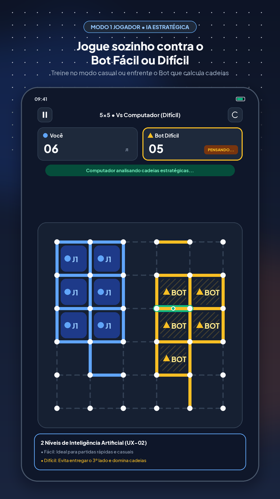
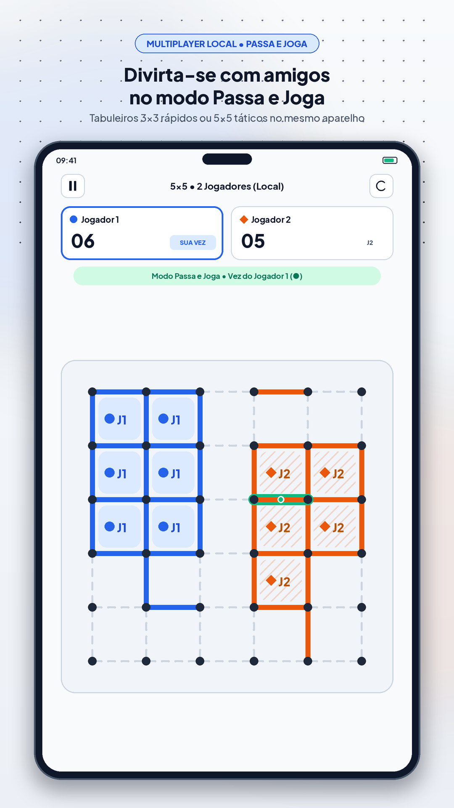
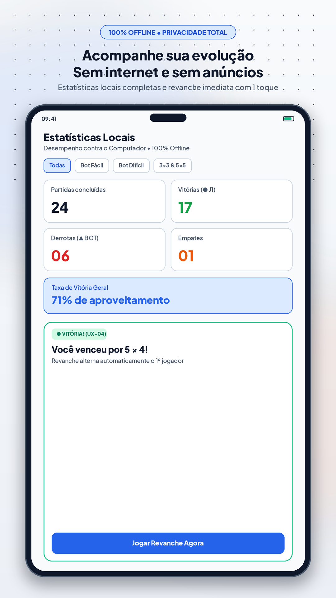

# Pontinhos

### Estratégia ponto a ponto • Dot-to-dot Strategy • Estrategia punto a punto

**O clássico jogo de papel e caneta reinventado para celulares e tablets — 100% Offline, Sem Anúncios e com Zero Coleta de Dados.**

  <a href="#português-brasil"><strong>🇧🇷 Português (Brasil)</strong></a> •
  <a href="#english"><strong>🇺🇸 English</strong></a> •
  <a href="#español"><strong>🇪🇸 Español</strong></a>

---

## 🇧🇷 Português (Brasil)

**Pontinhos** traz para o seu celular e tablet toda a nostalgia e a tensão tática do clássico *Jogo dos Pontinhos* de caderno escolar, com direção de arte artesanal **Tactile Paper & Ink**, resposta tátil precisa e respeito absoluto à sua privacidade.

### ✨ Por que jogar Pontinhos?

- **👆 Gesto Intuitivo de Toque e Arraste:** Toque em um ponto do tabuleiro e arraste o dedo até o ponto vizinho para desenhar seu traço com encaixe magnético suave — exatamente como puxar uma linha no papel (ou toque diretamente entre dois pontos).
- **🤖 Desafio Solo contra o Computador (IA):** Enfrente o Computador em dois níveis de dificuldade:
  - **Fácil (Casual):** ideal para partidas relaxantes ou para aprender a dinâmica do tabuleiro.
  - **Difícil (Estrategista):** evita entregar o 3º lado de um quadrado, conquista cadeias completas e calcula o menor sacrifício nas viradas de turno.
- **👥 2 Jogadores Local (Passa e Joga):** Divida a tela com um amigo ou familiar no mesmo aparelho, com alternância automática de quem começa na revanche.
- **📐 Dois Tamanhos de Tabuleiro:**
  - **3×3 Rápido** (16 pontos • 9 quadrados • 1 a 2 min): perfeito para intervalos curtos.
  - **5×5 Clássico** (36 pontos • 25 quadrados • 3 a 6 min): estratégia profunda e grandes cadeias.
- **✈️ 100% Offline:** Jogue no avião, no ônibus, na estrada ou em qualquer lugar sem precisar de internet ou pacote de dados.
- **🔒 Privacidade Total (Zero Coleta de Dados):** Sem cadastro, sem login, sem anúncios invasivos e sem rastreadores. Suas preferências e estatísticas ficam salvas apenas no seu próprio aparelho.
- **♿ Acessível e Confortável:** Temas **Claro** e **Escuro**, suporte a leitores de tela (*TalkBack* e *VoiceOver*) e identificação dupla por cores e símbolos geométricos (`● J1`, `■ J2`, `▲ BOT`).
- **🌍 Poliglota:** Disponível integralmente em **Português (Brasil)**, **Inglês (`English`)** e **Espanhol (`Español`)**.

### 🕹️ Como Jogar em 4 Passos

1. **Toque e Arraste:** Na sua vez, toque em um ponto e arraste o dedo até um ponto vizinho (horizontal ou vertical) para traçar uma linha.
2. **Feche Quadrados:** Quem traça o 4º e último lado de um quadrado conquista aquele território e marca **1 ponto**.
3. **Ganhe Turno Extra (Combo!):** Fechou um quadrado? Você ganha uma **jogada extra imediata**! Planeje sequências para conquistar vários quadrados seguidos.
4. **Vença a Partida:** Quando todos os quadrados forem conquistados, vence quem tiver o maior placar!

### 📱 Capturas de Tela

| Tela Inicial | Nova Partida | Partida 3×3 (Claro) | Partida 5×5 (Escuro) |
| :---: | :---: | :---: | :---: |
|  |  |  |  |

| Tutorial Passo a Passo | Resultado e Revanche | Estatísticas Locais | Configurações |
| :---: | :---: | :---: | :---: |
|  |  |  |  |

### 🛡️ Compromisso 100% Offline & Zero Coleta de Dados

O **Pontinhos** foi projetado desde a origem para respeitar você:
- **Zero coleta de dados pessoais:** não pedimos nome, e-mail, telefone ou localização.
- **Zero anúncios e zero rastreadores:** sua partida nunca é interrompida por propagandas.
- **Armazenamento 100% local:** suas opções de som, vibração, idioma, tema visual e histórico de partidas ficam guardadas exclusivamente no seu próprio celular ou tablet.

📄 **[Leia nossa Política de Privacidade completa](https://regardgames.github.io/pontinhos/privacy-policy.html)**

---

## 🇺🇸 English

**Pontinhos** brings the timeless fun and tactical tension of the classic pen-and-paper **Dots and Boxes** game to your phone and tablet, crafted with a **Tactile Paper & Ink** aesthetic, crisp haptic feedback, and absolute respect for your privacy.

### ✨ Highlights

- **👆 Intuitive Touch & Drag Gesture:** Touch any dot on the board and drag your finger to a neighboring dot to draw your line with smooth magnetic snapping — or tap directly between two dots.
- **🤖 Solo Challenge vs. Computer (AI):** Play against the Computer across two difficulty levels:
  - **Easy (Casual):** great for relaxing matches or learning the board dynamics.
  - **Hard (Strategist):** avoids giving away the 3rd side of a box, claims full chains, and calculates the smallest sacrifice when turns get tight.
- **👥 2 Players Local (Pass & Play):** Share the screen with a friend or family member on the same device, with automatic starter alternation on every rematch.
- **📐 Two Board Sizes:** **3×3 Quick** (16 dots • 9 boxes • 1–2 min) and **5×5 Classic** (36 dots • 25 boxes • 3–6 min).
- **✈️ 100% Offline:** Play on a plane, on the subway, on a road trip, or anywhere without internet or mobile data.
- **🔒 Total Privacy (Zero Data Collection):** No sign-up, no login, no ads, and no trackers. Your preferences and match stats stay saved only on your own device.
- **🌍 Multilingual:** Fully available in **Portuguese (`Português`)**, **English**, and **Spanish (`Español`)**.

### 🕹️ How to Play in 4 Steps

1. **Touch and Drag:** On your turn, touch a dot and drag your finger to an adjacent horizontal or vertical dot to draw a line.
2. **Claim Boxes:** Whoever draws the 4th and final side of a box claims that territory and scores **1 point**.
3. **Earn a Bonus Turn (Combo!):** Closed a box? You get an **immediate bonus move**! Chain boxes together to turn the match around.
4. **Win the Match:** When all boxes are claimed, the player with the highest score wins!

📄 **[Play the interactive web demo](https://regardgames.github.io/pontinhos/?lang=en)** • **[Read the Privacy Policy](https://regardgames.github.io/pontinhos/privacy-policy.html?lang=en)**

---

## 🇪🇸 Español

**Pontinhos** lleva a tu celular y tablet toda la diversión y la emoción táctica del clásico juego de papel y lápiz **Puntos y Cajas** (*Timbiriche / Cuadraditos*), con una estética artesanal **Tactile Paper & Ink**, respuesta táctil suave y respeto absoluto por tu privacidad.

### ✨ Características Principales

- **👆 Gesto Intuitivo de Tocar y Arrastrar:** Toca un punto del tablero y arrastra el dedo hasta un punto vecino para trazar tu línea con ajuste magnético suave — o toca directamente entre dos puntos.
- **🤖 Desafío Individual contra la Computadora (IA):** Enfréntate a la Computadora en dos niveles de dificultad (**Fácil** para partidas casuales y **Difícil** para duelos estratégicos de cadenas).
- **👥 2 Jugadores Local (Pasa y Juega):** Comparte la pantalla con un amigo o familiar en el mismo dispositivo, alternando automáticamente quién empieza en cada revancha.
- **📐 Dos Tamaños de Tablero:** **3×3 Rápido** (16 puntos • 9 cajas • 1 a 2 min) y **5×5 Clásico** (36 puntos • 25 cajas • 3 a 6 min).
- **✈️ 100 % sin Conexión:** Juega en el avión, en el autobús, de viaje o en cualquier lugar sin necesitar internet ni datos móviles.
- **🔒 Privacidad Total (Cero Recopilación de Datos):** Sin registro, sin anuncios y sin rastreadores. Tus preferencias y estadísticas se guardan únicamente en tu propio dispositivo.
- **🌍 Multilingüe:** Totalmente disponible en **Portugués (`Português`)**, **Inglés (`English`)** y **Español**.

### 🕹️ Cómo Jugar en 4 Pasos

1. **Toca y Arrastra:** En tu turno, toca un punto y arrastra el dedo hasta un punto vecino (horizontal o vertical) para trazar una línea.
2. **Cierra Cajas:** Quien traza el 4.º y último lado de una caja conquista ese territorio y suma **1 punto**.
3. **Gana un Turno Extra (¡Combo!):** ¿Cerraste una caja? ¡Obtienes una **jugada extra inmediata**! Conecta cadenas de cajas para asegurar la victoria.
4. **Gana la Partida:** Cuando se conquistan todas las cajas, ¡gana quien tenga más puntos en el marcador!

📄 **[Juega en el minitablero interactivo web](https://regardgames.github.io/pontinhos/?lang=es)** • **[Lee la Política de Privacidad](https://regardgames.github.io/pontinhos/privacy-policy.html?lang=es)**

---

## 🔗 Links Oficiais & Downloads

- 🌐 **Página Oficial & Demo Interativa:** [https://regardgames.github.io/pontinhos/](https://regardgames.github.io/pontinhos/)
- 📦 **Download do APK Android (`v0.1.0-beta.1`):** [Baixar `pontinhos-v0.1.0-release.apk`](https://github.com/regardgames/pontinhos/releases/download/v0.1.0-beta.1/pontinhos-v0.1.0-release.apk)
- 🔒 **Política de Privacidade (PT / EN / ES):** [https://regardgames.github.io/pontinhos/privacy-policy.html](https://regardgames.github.io/pontinhos/privacy-policy.html)
- 💬 **Sugestões e Feedback:** [GitHub Issues (`regardgames/pontinhos`)](https://github.com/regardgames/pontinhos/issues)

---

**Criado com orgulho pela Regard Games — Picos, Piauí, Brasil 🇧🇷**  
*100% Offline • Zero Coleta de Dados • Feito para quem ama estratégia clássica.*

